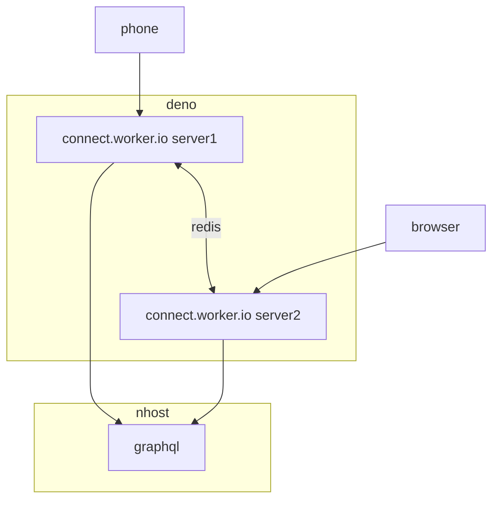
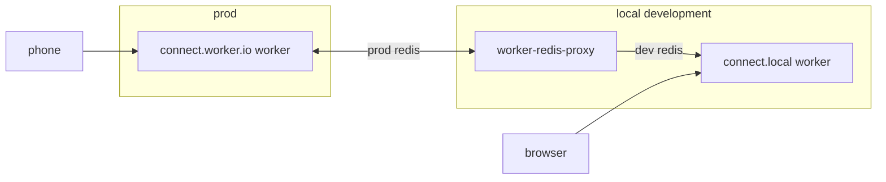
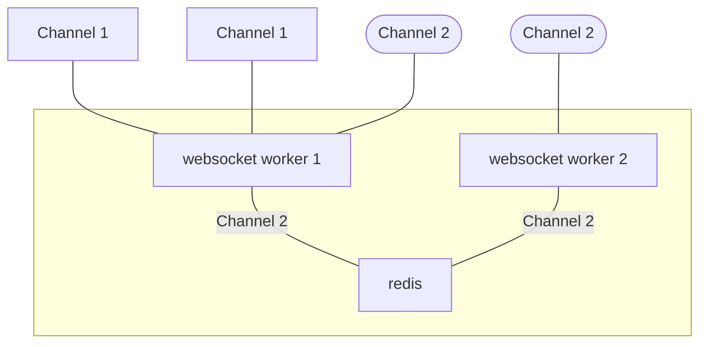

# Architecture

### Production



### Local development




# Websocket router+channels and user MenuModel handling


Roles:

 - Routes channel messages to all other listeners
 - If the websocket URL has `?control=<number>`, then load the matching `MenuModel+Controller`
   - channel all messages to/from the websocket pipes and the `MenuModel+Controller`
   - While the user is connected, refresh the notion slides
   - The control number is the priority
   - `control=0` means no control


## Role: router

Connects websocket channels (`https://connect.superslides.io/<channel>`) where any message from one channel connection is sent to all *other* channel connections.


## Role: update users menus+items from notion

Automatically. As long as the user is connected in any way, poll as often as allowed for updates. Fail fast and early and easily, but keep trying to update. Allow the user to be notified of updates.

This way, the user just doesn't have to think about anything: stuff just gets updated automatically

## Architecture

Two things: 1) deno workers connected to 2) a single redis instance for channel pub/sub.

For now, there is a single redis instance, deployed with Digital Ocean, publicly available on a random port, but secured with a password. In the future this will be expanded for redundancy and more throughput, and switchout out for a more performant system eventually. For now, redis is plenty fast enough.

Only the pub/sub system is used, which is ephemeral. This can be easily locked down further when the number of users justifies.

[View](https://mermaid.ink/svg/pako:eNp1UctuwjAQ_BVrT61EDjGccmz5g3JjezD2prFI7MhZy0LAv-M0gIKa7snz8Hi0PoP2hqCCuvVJNyqw2G3RiTyx3CN8Nso5akWJ8H2n5TK9fpvxMvPvd2GzICAP8fATVN8I1VuRDeI3CRnZ2ECarXdi9zExaWyS6DB4fSQWyYcjhdnb4yS55JFT6tMVyNhhdqkURVGIy7Pd5Y9D_uPgsRo580iPU1QqH1t6hetXuJmgRAcr6Ch0ypr8CedRRuCGOkKo8tFQrWLLCOiu2aoi-6-T01BxiLSC2BvFtLUq77KDqlbtQNcbJkuOyw)



## Deployment

Hosted on [Deno Deploy](https://console.deno.com/metapage/websocket-router) (not Deploy
Classic). Production URL: <https://websocket-router.metapage.deno.net>

```sh
just deploy
```

The deploy configuration lives in the `deploy` block of `deno.json` — org, app, and the
`src/serve.ts` entrypoint. That block takes precedence over anything set in the Deno
Deploy dashboard, so change it here rather than there. `deno deploy` uploads the whole
working tree (minus anything in `.gitignore` and `node_modules`), which is how `views/`
and `public/` reach the runtime.

Authentication: locally `deno deploy` uses the device login from `deno deploy login`. Deploy
Classic `ddp_` tokens are *not* valid — if a stale `DENO_DEPLOY_TOKEN` is exported it will
override the device login and every deploy will fail with `AUTH_INVALID_TOKEN`.

Environment variables are set on the application, not baked into the deploy:

```sh
just env-list                    # show what production has
just env-push                    # load ./.env into the application
just logs                        # tail production logs
```

`REDIS_URL` (secret) and `APP_FQDN` are both required — the server throws on startup
without `REDIS_URL`, and `APP_FQDN` is what the index page QR code points at.