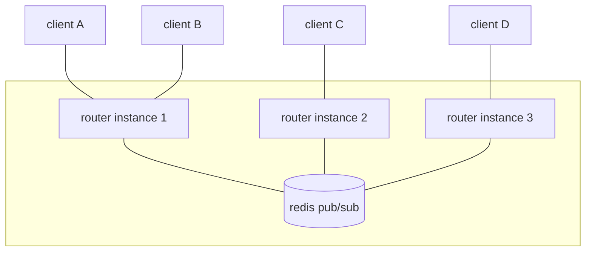

# Websocket Router

A public address space for realtime messages.

Connect a websocket to any URL. Everything you send is delivered to **every other
client on that same URL**, and to nobody else. No accounts, no SDK, no schema, no
setup.

- **Live**: <https://router.metapage.io/>
- **Documentation**: <https://router.metapage.io/docs/>
- **Deploy console**: <https://console.deno.com/metapage/websocket-router>

```js
const ws = new WebSocket(
  "wss://router.metapage.io/a-name-nobody-will-guess",
);

ws.onmessage = (event) => console.log("peer said:", event.data);
ws.onopen = () => ws.send(JSON.stringify({ hello: "world" }));
```

```sh
curl -X POST \
  https://router.metapage.io/a-name-nobody-will-guess \
  -d '{"temperature": 21.4}'
```

## The one rule

A message goes to every listener on the channel **except the sender**. That
asymmetry is what lets symmetric peers broadcast freely without echoing
themselves.

`POST` is the exception: it has no socket to exclude, so it reaches everyone.

## What it is not

No persistence, no replay, no delivery guarantees, and no authentication beyond
the secrecy of the channel name. It is a router, not a broker. See
[Guarantees & limits](docs/reference/guarantees.md).

## Open science infrastructure

This runs as public infrastructure: free to use, and free to walk away from.

A lot of realtime glue in research never gets built, because standing up a server
is not worth it for one figure, one instrument, or one workshop. The work stays
on somebody's laptop, or it ends up inside a platform that outlives the grant
that paid for it. Here a channel is a name — nothing to sign up for, no account
to be locked out of, no per-seat tier.

Everything needed to run your own copy is in this repository, [MIT licensed](LICENSE), and [self-hosting](docs/guide/self-hosting.md) is a redis and
a single process. If `router.metapage.io` disappears tomorrow, change the
hostname and what you built keeps working.

## Commands

`just` on its own lists everything.

```sh
just dev          # run locally with --watch on :3077 (needs a redis)
just test         # integration tests against a disposable redis in docker
just fmt          # format everything
just ci           # exactly what CI enforces
just docs-dev     # live-reloading documentation
just deploy       # type check, build docs, deploy to Deno Deploy
```

## Architecture

Identical stateless instances, connected by redis pub/sub. Only pub/sub is used
— nothing is written to a key and nothing is persisted.



A message sent by client A is written directly to A's local peers, and published
to redis prefixed with the sending instance's id. Every instance receives it; the
originating one recognises its own prefix and drops it, and the others strip the
prefix and fan out to their own sockets.

Each instance holds exactly **one** redis subscription per channel, however many
local sockets that channel has. That is what makes delivery exactly-once.

| File                    | Responsibility                                 |
| ----------------------- | ---------------------------------------------- |
| `src/serve.ts`          | Entrypoint                                     |
| `src/server.ts`         | `Deno.serve` plus the websocket/HTTP split     |
| `src/handlerWs.ts`      | All routing: channels, sockets, redis fan-out  |
| `src/handlerHttpOak.ts` | HTTP routes and static file serving            |
| `src/redis/client.ts`   | Publish and subscribe clients                  |
| `src/id.ts`             | Per-process instance id used for loop breaking |
| `docs/`                 | The vitepress site served at `/docs`           |
| `test/integration/`     | Real servers, real redis, real websockets      |

## HTTP surface

| Method | Path           | Purpose                                     |
| ------ | -------------- | ------------------------------------------- |
| `GET`  | `/`            | Landing page                                |
| `GET`  | `/docs/*`      | Documentation                               |
| `GET`  | `/healthcheck` | `OK`                                        |
| `GET`  | `/:channel`    | Channel page — QR code plus a metaframe     |
| `POST` | `/:channel`    | Broadcast the request body to all listeners |
| `WS`   | `/:channel`    | Join the channel                            |

## Development

Needs [Deno](https://deno.land) 2.x, [just](https://github.com/casey/just),
Docker (for the test redis) and Node.js 20+ (for the docs).

```sh
docker run -d -p 6379:6379 redis:7-alpine
just dev
```

Configuration is environment variables, from `.env` locally:

| Variable    | Required | Default                  | Purpose                          |
| ----------- | -------- | ------------------------ | -------------------------------- |
| `REDIS_URL` | **yes**  | —                        | Redis connection string          |
| `PORT`      | no       | `3077`                   | Listen port                      |
| `APP_FQDN`  | no       | `http://localhost:$PORT` | Host encoded in channel QR codes |

CI runs on every push to a branch other than `main` and on pull requests into it:
formatting, lint, type check, docs build, and the integration suite against a
redis service container. `just ci` runs the same thing locally.

## Documentation

The docs are a separate npm project in `docs/`, built by vitepress into
`docs/.vitepress/dist` and mounted by the server at `/docs`.

```sh
just docs-dev     # live reload
just docs-build   # what CI checks; also fails on dead internal links
```

`docs/.vitepress/dist` is build output: gitignored, never committed, and built at
deploy time.

It still reaches production because the `deploy.include` list in `deno.json`
names it explicitly. `deno deploy` honours `.gitignore`, but an explicitly
included **plain path** (never a glob) is injected as a `!` negation and
overrides it. That `include` list is also the complete set of files uploaded —
15 runtime files plus the built docs — so tests, docs sources and CI config never
leave your machine.

`just deploy` rebuilds the docs, refuses to deploy if they are missing, and
smoke-tests the live deployment afterwards with `just verify-production`.

## Deployment

Hosted on [Deno Deploy](https://console.deno.com/metapage/websocket-router) (not
Deploy Classic), against a managed redis configured through `REDIS_URL`.

Because only pub/sub is used, that redis stores nothing. Losing it drops
in-flight messages and nothing else — there is no state to restore, and no
migration to run when it is replaced.

```sh
just deploy
just logs        # tail production logs
just env-list    # what production is using
just env-push    # load ./.env into the application
```

The deploy configuration lives in the `deploy` block of `deno.json` — org, app,
and the `src/serve.ts` entrypoint. That block takes precedence over anything set
in the dashboard, so change it here rather than there.

Authentication uses the device login from `deno deploy login`. Deploy Classic
`ddp_` tokens are **not** valid — a stale `DENO_DEPLOY_TOKEN` in the environment
overrides the device login and every deploy fails with `AUTH_INVALID_TOKEN`.

`REDIS_URL` (secret) and `APP_FQDN` are set on the application, not baked into a
deploy. The server throws on startup without `REDIS_URL`.

## License

[MIT](LICENSE).
