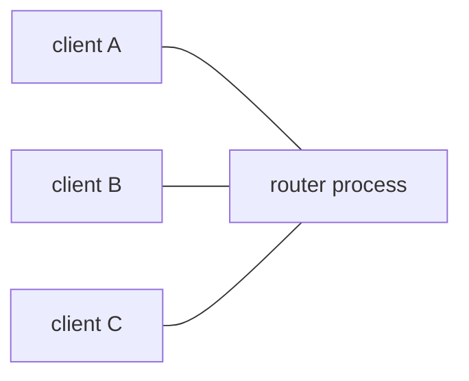

# Websocket Router

A public address space for realtime messages.

Connect a websocket to any URL. Everything you send is delivered to **every
other client on that same URL**, and to nobody else. No accounts, no SDK, no
schema, no setup.

- **Live**: <https://router.metapage.io/>
- **Documentation**: <https://router.metapage.io/docs/>

```js
const ws = new WebSocket("wss://router.metapage.io/a-name-nobody-will-guess");

ws.binaryType = "arraybuffer";
ws.onmessage = (event) => console.log("peer said:", event.data);
ws.onopen = () => ws.send(JSON.stringify({ hello: "world" }));
```

```sh
curl -X POST \
  https://router.metapage.io/a-name-nobody-will-guess \
  -d '{"temperature": 21.4}'
```

## The one rule

A message goes to every listener on the channel **except the sender**. That
asymmetry is what lets symmetric peers broadcast freely without echoing
themselves.

`POST` is the exception: it has no socket to exclude, so it reaches everyone.

Text and binary frames are both routed, unchanged and unconverted.

## What it is not

No persistence, no replay, no delivery guarantees, and no authentication
beyond the secrecy of the channel name. It is a router, not a broker. See
[Guarantees & limits](docs/reference/guarantees.md).

## Open science infrastructure

This runs as public infrastructure: free to use, and free to walk away from.

A lot of realtime glue in research never gets built, because standing up a
server is not worth it for one figure, one instrument, or one workshop. The
work stays on somebody's laptop, or it ends up inside a platform that outlives
the grant that paid for it. Here a channel is a name — nothing to sign up for,
no account to be locked out of, no per-seat tier.

Everything needed to run your own copy is in this repository,
[MIT licensed](LICENSE), and [self-hosting](docs/guide/self-hosting.md) is one
Node process on one small VM. If `router.metapage.io` disappears tomorrow,
change the hostname and what you built keeps working.

## Architecture

One process. The whole of the application state is:

```
Map<string, Set<WebSocket>>
```

A message arrives on one socket and is written directly to the other sockets
on that channel.



An earlier version ran several stateless instances joined by Redis pub/sub.
Redis stored nothing — only pub/sub, no keys, nothing persisted — and existed
solely so that several processes could reach each other, which the hosting
platform imposed. One process needs no bus, and removing it made the delivery
contract *stronger*: there is no cross-instance ordering gap, no window where
Redis is down and peers silently stop hearing each other, and no instance-id
prefix on every payload.

> [!IMPORTANT]
> **Each deployed host is an independent router.** Channel membership lives in
> one process's memory, so two hosts are two separate routers. Do not put
> several behind one hostname — a load balancer would split every channel
> silently, with both peers looking healthy and never hearing each other. Give
> each host its own name.
>
> `deploy/deploy.sh` takes a list of hosts because deploying one build to
> several independent routers is useful. It is not building a cluster.

| Path | Responsibility |
| --- | --- |
| `src/index.ts` | Entrypoint; owns the listeners and shutdown |
| `src/channels.ts` | The router: channels, subscribers, fan-out |
| `src/wsServer.ts` | Websocket handling, size limits, keepalives |
| `src/httpApp.ts` | HTTP routes, and the minimal port-80 redirect app |
| `src/staticAssets.ts` | Static files, preferring precompressed variants |
| `src/admin/` | Panel API and session authentication |
| `src/inspect/` | Connection inspector at a secret path |
| `src/tls/` | ACME issuance, renewal, certificate storage |
| `src/config.ts` | Boot-time configuration from the environment |
| `src/settings.ts` | Runtime settings the admin panel can change |
| `src/logger.ts` | Rotated JSON logs plus a ring buffer for the panel |
| `src/reserved.ts` | Paths that cannot be channels |
| `web/` | Browser bundles: channel page, landing page, admin panel, inspector |
| `docs/` | The vitepress site served at `/docs` |
| `deploy/` | Host bootstrap, deploy, rollback, status |
| `test/integration/` | Real processes, real sockets, real ACME |

## HTTP surface

| Method | Path | Purpose |
| --- | --- | --- |
| `GET` | `/` | Landing page |
| `GET` | `/docs/*` | Documentation |
| `GET` | `/admin` | [Admin panel](docs/guide/admin.md), if enabled |
| `GET` | `/<INSPECT_KEY>` | [Connection inspector](docs/guide/inspector.md), if enabled |
| `GET` | `/healthcheck` | `OK` |
| `GET` | `/:channel` | Channel page — QR code plus a metaframe |
| `POST` | `/:channel` | Broadcast the request body to all listeners |
| `WS` | `/:channel` | Join the channel |

`/admin`, `/docs`, `/healthcheck`, `/_` and `/.well-known` are reserved and
can never be channel names — enabling the admin panel must not take a name
somebody was already using. `INSPECT_KEY`, when set, is reserved the same way,
which is why it has a minimum length: a short key would be a plausible channel
name to take.

## Development

Needs [Node.js 22+](https://nodejs.org),
[just](https://github.com/casey/just), and Docker for the tests.

```sh
just install
just dev          # http://localhost:3077, admin password "dev"
```

`just dev` builds the browser bundles and then watches both sides: `web/`
changes are rebuilt by Vite and picked up without a restart, `src/` changes
restart the server.

```sh
just              # list every recipe
just prod         # full build, NODE_ENV=production, as production runs it
just check        # type check server, browser and tests
just build        # server, browser bundles, precompressed assets
just test         # the integration suite in docker-compose
just test-acme    # certificate issuance against pebble
just test-local   # the suite on the host: faster, narrower
just docs-dev     # live-reloading documentation
just ci           # everything CI enforces
```

### Tests

Nothing is mocked. Every test starts a real `node dist/server/index.js` and
drives it over real sockets, because the things this project can get wrong —
TLS, privilege level, precompressed files on disk, log rotation in a worker
thread, the process lifecycle — only exist in a real process.

`just test` runs in docker-compose, which is where two requirements can
actually be verified: the server running as a non-root user, and certificate
issuance against [pebble](https://github.com/letsencrypt/pebble), Let's
Encrypt's own test ACME server. `just test-local` is faster but skips both.

See [Contributing](docs/guide/contributing.md).

## Deployment

One Node process per host, under pm2, started by systemd, as an unprivileged
user, with its own Let's Encrypt certificate obtained in-process. No reverse
proxy, no certbot, no container runtime required.

```sh
# once per host, as root
ssh root@your-host 'bash -s' < deploy/bootstrap.sh
ssh root@your-host 'nano /opt/websocket-router/env'   # TLS_DOMAINS, TLS_EMAIL, ADMIN_PASSWORD

# then, as often as you like
echo your-host > deploy/hosts
just deploy
```

`bootstrap.sh` is idempotent. It creates the service user, installs Node and
pm2, registers pm2 with systemd so the router survives a reboot, configures
`pm2-logrotate`, and grants `CAP_NET_BIND_SERVICE` through a systemd drop-in
so ports 80 and 443 work **without running as root**.

> Why a capability and not `setcap`: `setcap` on the `node` binary would let
> *every* Node process on the box bind low ports forever.
> `AmbientCapabilities` on the unit grants it to this service only, and
> `CapabilityBoundingSet` caps what it could ever acquire.

`just deploy` builds locally, ships a tarball, and on each host unpacks to a
timestamped release, installs production dependencies, atomically repoints
`current`, reloads pm2, and **waits for `/healthcheck`** — rolling back to the
previous release automatically if it never comes up.

```sh
just deploy-dry       # build and package, touch no host
just status           # what each host is running
just rollback host    # back to the previous release
just logs host        # tail pm2 output
just verify https://router.example.com
```

Release trees are owned by `root:router` and are not writable by the service
user, so a compromised router process cannot rewrite the code that runs next
boot.

### TLS

Certificates are obtained and renewed in-process with
[`acme-client`](https://www.npmjs.com/package/acme-client) over HTTP-01, and
swapped into the running server with `setSecureContext` — no restart, no
dropped connections. Port 80 serves ACME challenges and a 301 to https, and
nothing else.

Point DNS at the host **before** enabling TLS, and test against Let's
Encrypt's staging directory first. Full lifecycle and troubleshooting in
[Self-hosting](docs/guide/self-hosting.md#tls-and-certificates).

### Admin panel

Set `ADMIN_PASSWORD` to enable `/admin`, where you can change the maximum
message size live and read the logs. Unset, the whole subtree returns 404 —
there is no default credential. See [Admin panel](docs/guide/admin.md).

### Connection inspector

Set `INSPECT_KEY` to serve a live view of what is connected at `/<that key>`:
a list of every channel with a connection, and — on clicking one — how long
each socket has been up, its `Origin` and `User-Agent`, and the traffic as it
arrives. Clicking is the only thing that subscribes. The path is the whole
credential — there is no login, and a wrong guess is served an ordinary
channel page. Unset, the route does not exist. See [Connection
inspector](docs/guide/inspector.md).

### Configuration

Environment variables, in `/opt/websocket-router/env` on a deployed host.
Every one is documented in
[Configuration](docs/reference/configuration.md); the ones you will actually
set:

| Variable | Purpose |
| --- | --- |
| `TLS_ENABLED`, `TLS_DOMAINS`, `TLS_EMAIL` | Certificates |
| `ADMIN_PASSWORD`, `ADMIN_SESSION_SECRET` | Admin panel |
| `DATA_DIR`, `LOG_DIR` | Writable state and logs |
| `WS_DEFAULT_MAX_MESSAGE_BYTES` | Starting message size limit |
| `TRUST_PROXY` | Set behind a reverse proxy |

## License

[MIT](LICENSE).
