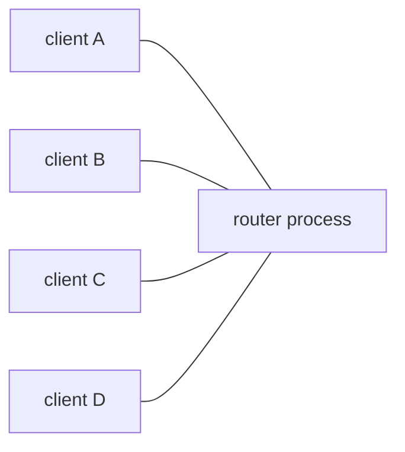

# Architecture

One Node process. The whole of the application state is a map from channel
name to the set of sockets listening on it.

```
Map<string, Set<WebSocket>>
```

That is not a simplification for the sake of the diagram. It is the data
structure, in `src/channels.ts`.



A message arrives on one socket and is written directly to the other sockets
on that channel. There is no hop in between, nothing to serialise it through,
and nothing to be down.

## What changed, and why

An earlier version ran several identical stateless instances joined by Redis
pub/sub. Each instance held the same in-memory map, published every message to
Redis prefixed with its own instance id, and dropped its own echo on the way
back.

Redis was never storing anything — only pub/sub was used, no keys were
written, nothing was persisted. Its sole job was letting several processes
reach each other. That was necessary because the hosting platform ran several
processes whether or not that was wanted.

One process needs no bus, and removing it made the delivery contract
**stronger**, not weaker. These caveats simply stopped existing:

- *"Peers on the sender's own instance receive slightly before peers
  elsewhere"* — there is one instance.
- *"Redis unreachable: cross-instance delivery stops, senders are not told"* —
  there is nothing to be unreachable.
- The instance-id prefix stripped off every payload, and the one-subscription-
  per-channel-per-instance bookkeeping that made delivery exactly-once.

The cost is real and worth stating plainly: a deployment is one process.

## The consequence: a host is a router

Channel membership lives in one process's memory. Two hosts are two
independent routers that happen to run the same code.

::: warning
Do not put several hosts behind one hostname. A load balancer would split
every channel silently — two peers connect, both look healthy, and never hear
each other. Give each host its own name.
:::

`deploy/deploy.sh` accepts a list of hosts because deploying one build to
several independent routers is useful. It is not building a cluster. See
[Self-hosting](/guide/self-hosting).

Scaling is therefore vertical, which is also why pm2 runs in `fork` mode with
`instances: 1`. Cluster mode here would not be a performance win; it would be
the same correctness bug inside a single box.

## Request routing

Every path that is not something else is a channel. The exceptions are a short
reserved list, in `src/reserved.ts`:

| Prefix | |
| --- | --- |
| `/healthcheck` | `OK` |
| `/docs` | the documentation site |
| `/admin` | the [admin panel](/guide/admin) |
| `/_` | browser bundles |
| `/.well-known` | ACME challenges |

These are reserved **whether or not the feature behind them is enabled**, and
by both the HTTP stack and the websocket upgrade handler. Two reasons:

- enabling the admin panel must never take a channel name somebody was
  already using;
- a name that means one thing over HTTP and another over a websocket is a
  trap, when the security model is that a channel name is a secret.

`INSPECT_KEY`, when set, is reserved by the same check — the one prefix that
is not a fixed string. Hence its 16-character minimum: a short key would be a
plausible channel name, and reserving it would take that name away from
whoever was using it. See [Connection inspector](/guide/inspector).

Everything else — `GET /:channel` renders the channel page, `POST /:channel`
broadcasts, a websocket upgrade joins.

## The pieces

| File | Responsibility |
| --- | --- |
| `src/index.ts` | Entrypoint. Owns the listeners and shutdown. |
| `src/channels.ts` | The router: channels, subscribers, fan-out. |
| `src/wsServer.ts` | Websocket handling, size limits, keepalives. |
| `src/httpApp.ts` | HTTP routes, and the minimal port-80 redirect app. |
| `src/staticAssets.ts` | Static files, preferring precompressed variants. |
| `src/channelPage.ts` | QR code injection into the built channel page. |
| `src/admin/` | Panel API and session authentication. |
| `src/inspect/` | The connection inspector and its key handling. |
| `src/tls/` | ACME issuance, renewal, and on-disk certificate storage. |
| `src/config.ts` | Boot-time configuration from the environment. |
| `src/settings.ts` | Runtime settings the panel can change. |
| `src/logger.ts` | Rotated JSON logs plus an in-memory ring for the panel. |
| `src/reserved.ts` | Paths that cannot be channels. |
| `web/channel/` | The channel page and landing page bundles. |
| `web/admin/` | The admin panel bundle. |
| `web/inspect/` | The connection inspector bundle. |
| `test/integration/` | Real processes, real sockets, real ACME. |

## The browser side

Vite builds four bundles into `dist/web`, served under `/_/` with
content-hashed filenames and a one-year immutable cache.

Note that the inspector's bundle is one of them: a public, cacheable asset.
The secret that opens the inspector is therefore read from the URL at runtime
rather than compiled in, because anything compiled in would be served to
anyone who asked for the bundle.

The channel page previously loaded `@metapages/*` and
`reconnecting-websocket` from a CDN at runtime, which made every channel page
depend on jsdelivr being up. They are npm dependencies now and ship inside
the bundle.

## Compression

Static assets are compressed **at build time**, not per request:
`npm run compress` writes a `.br` and a `.gz` beside every compressible
artifact, and the server picks whichever the client accepts and streams it
straight off disk.

That ordering is the point. Brotli at quality 11 is far too slow to run per
request, and free when it was done once — about 77% smaller than the
originals on this codebase. Dynamic responses (the channel page, admin JSON)
are gzipped on the fly instead, where the CPU cost is proportionate.

Every response carries `Vary: Accept-Encoding`, because the same URL now has
up to three representations and a shared cache that ignores this would hand
brotli to a client that cannot read it.

## Failure behaviour

| Failure | Result |
| --- | --- |
| Process restarts | Every connection closes with 1001 "going away". Clients reconnect; missed messages are gone. |
| Process crashes | pm2 restarts it, backing off, and gives up after 10 failures in quick succession rather than crash-looping quietly. |
| Host reboots | systemd starts pm2, pm2 starts the router. |
| Certificate renewal fails | Logged, retried on the next check. The existing certificate keeps serving. |
| A client stops reading | Messages to that socket are dropped once 8 MB is unflushed. Other clients are unaffected. |
| Oversize frame | Socket closed with 1009. |
| Disk fills with logs | It should not: retention is bounded by `LOG_RETAIN_FILES × LOG_MAX_SIZE`. |

A deploy closing every connection is within the contract, not an incident —
see [Guarantees & limits](/reference/guarantees). Clients are expected to
reconnect, and the reference client does.
