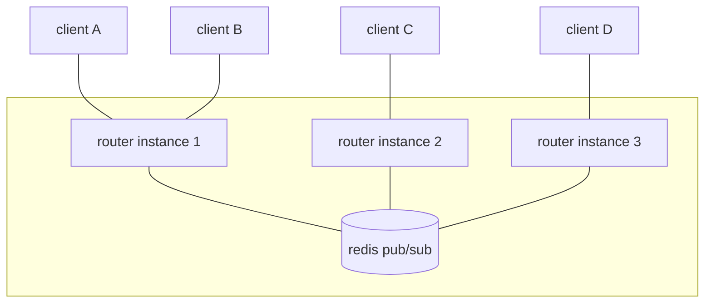

# Architecture

The whole system is a few hundred lines. This page is the mental model you need
to reason about its behaviour under load and failure.

## Shape

Every instance is identical and stateless apart from the sockets it happens to
be holding. Redis is the only shared component, and only its **pub/sub** is used
— nothing is written to a key, nothing is persisted, nothing is read back.

## The path of a message

Client A, connected to instance 1, sends `hello` on channel `room-8f2a1c`:

1. Instance 1 writes `hello` directly to every other socket it holds on
   `room-8f2a1c`. Client B receives it. Client A does not — the sender is
   excluded by identity, not by any id in the payload.
2. Instance 1 publishes `<instance-1-id>:hello` to the redis channel
   `room-8f2a1c`.
3. Every instance subscribed to that channel receives the publication —
   including instance 1 itself.
4. Instance 1 sees its own id prefix and drops the message. That prefix is the
   entire loop-prevention mechanism.
5. Instances 2 and 3 strip the prefix and write `hello` to all their sockets on
   the channel. Clients C and D receive it.

The instance id is six random alphanumeric characters generated at process
start, and the prefix is stripped before delivery, so clients never see it.

## One subscription per channel per instance

An instance holds **exactly one** redis subscription per channel no matter how
many local sockets that channel has. The first socket subscribes; the last one
to leave unsubscribes.

This matters for correctness, not just efficiency. Redis invokes every
registered listener, and each listener fans out to all local sockets — so
subscribing per socket would deliver N copies to each of N local sockets. One
subscription per channel is what makes exactly-once local delivery hold.

The unsubscribe path removes the channel from the local map _before_ awaiting
redis, so a client reconnecting during that round trip creates a fresh
subscription rather than racing the teardown.

## Consequences of the design

**Horizontal scaling is free for connections.** Instances share nothing, so
adding one adds capacity for sockets immediately. Client-to-instance assignment
does not matter.

**Redis is the throughput ceiling.** Every message crosses it once, regardless
of how many clients are on the sending instance. Fan-out cost is
`O(instances subscribed)` on redis and `O(local sockets)` on each instance.

**Redis is the single point of failure — partially.** If redis is unreachable,
clients on the same instance still reach each other, because local delivery is
direct. Cross-instance delivery stops. Publish and subscribe failures are logged
and swallowed; senders are not told.

**Nothing survives a restart.** Sockets die with the process and channels cease
to exist. Clients must reconnect, and they will re-establish channels
automatically as they do.

**No backpressure anywhere.** A fast sender with slow receivers buffers in the
server process. This is the main thing to be careful about at high message
rates; see [rate limiting yourself](/guide/patterns#rate-limiting-yourself).

## HTTP surface

The same process serves plain HTTP on the same port, via
[oak](https://jsr.io/@oak/oak):

| Route              | Purpose                                            |
| ------------------ | -------------------------------------------------- |
| `GET /`            | Landing page                                       |
| `GET /docs/*`      | This documentation, built by vitepress             |
| `GET /healthcheck` | Liveness probe, returns `OK`                       |
| `POST /:channel`   | Broadcast the request body to all listeners        |
| `GET /:channel`    | The channel page — QR code plus a metaframe bridge |

An upgrade request is routed to the websocket handler; everything else goes to
oak. CORS is open on every route, deliberately: clients are arbitrary pages on
arbitrary origins.

## Source layout

| File                    | Responsibility                                          |
| ----------------------- | ------------------------------------------------------- |
| `src/serve.ts`          | Entrypoint — reads `PORT`/`APP_FQDN`, starts the server |
| `src/server.ts`         | `Deno.serve` plus the websocket/HTTP split              |
| `src/handlerWs.ts`      | All routing: channels, sockets, redis fan-out           |
| `src/handlerHttpOak.ts` | HTTP routes and static file serving                     |
| `src/redis/client.ts`   | The publish and subscribe clients                       |
| `src/id.ts`             | The per-process instance id used for loop breaking      |

`src/handlerWs.ts` is the file to read if you read only one.
